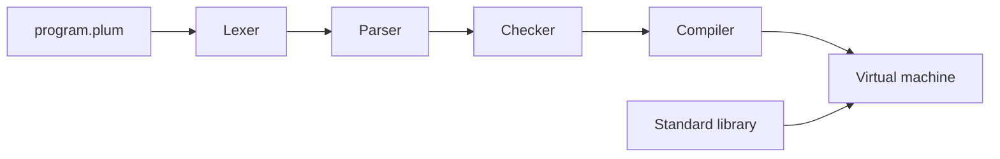

# Contributing to Plumlang

Thank you for your interest in Plumlang! Plumlang is a small, fast,
memory-safe programming language written in C, an Elixpo production. You can
contribute with nothing but a C compiler.

Please read the [Code of Conduct](CODE_OF_CONDUCT.md) first; it applies
everywhere in the project. The binding rules every contribution follows,
licensing included, are in [PREAMBLE.md](PREAMBLE.md).

## The project at a glance

| Part | Where | Language |
|---|---|---|
| Lexer, parser, checker, compiler | `src/lexer/`, `src/parser/`, `src/check/`, `src/compiler/` | C11 |
| Virtual machine and memory management | `src/vm/` | C11 |
| Standard library | `src/stdlib/` | C11 (and Plumlang) |
| The `plum` command | `src/cli/` | C11 |
| Public headers | `include/plum/` | C11 |
| Golden-file tests | `tests/` | Plumlang + expected output |
| Language specification and docs | `docs/` | Markdown |

Most of these directories arrive with the stages of the
[roadmap](https://github.com/plumlang/plumlang/issues/36).



## Pick a path

| Path | Issue form | Start from |
|---|---|---|
| Fix a bug | [Bug report](https://github.com/plumlang/plumlang/issues/new?template=bug_report.yml) | [good first issues](https://github.com/plumlang/plumlang/issues?q=is%3Aopen+label%3A%22good+first+issue%22) |
| Change the language | [Language proposal](https://github.com/plumlang/plumlang/issues/new?template=language_proposal.yml) | [`docs/spec.md`](docs/spec.md) |
| Add to the standard library | [Library proposal](https://github.com/plumlang/plumlang/issues/new?template=stdlib_proposal.yml) | `src/stdlib/` |
| Build a roadmap item | Comment on its issue in [#36](https://github.com/plumlang/plumlang/issues/36) | The issue's scope and "done when" list |

Anything else (tooling, docs, the website) goes in the
[other idea form](https://github.com/plumlang/plumlang/issues/new?template=feature_request.yml).
A typo or a one-line fix can go straight to a pull request.

## Build and test

You need a C11 compiler (GCC, Clang or MSVC) and `make` (or CMake).

```bash
git clone https://github.com/plumlang/plumlang && cd plumlang
make                 # builds ./plum
make test            # runs the test suite
make sanitize test   # the same, under AddressSanitizer and UBSan
./plum version
```

On Windows with MSVC:

```bat
cmake -B build && cmake --build build --config Release
```

## Workflow

1. For anything larger than a small fix, open the issue form for your path
   or comment on an existing issue first, so we can agree on the approach
   before you spend time on it.
2. Fork the repository and branch from `main`. Name the branch after the
   issue, for example `vm/issue-15`; CI then links the pull request to the
   issue.
3. Make the change, with tests. One pull request does one thing, closes one
   issue, and has a single author.
4. Run the checks below.
5. Open a pull request: what changed and why, what you tested, and on which
   platforms. Link the issue ("Closes #15").
6. A maintainer reviews. We squash-merge once it's approved.

## Checks before a pull request

- [ ] `make` builds with no warnings.
- [ ] `make test` passes, and `make sanitize test` reports nothing.
- [ ] New behaviour has a test under `tests/`; a fix has the test that would
      have caught the bug.
- [ ] A change to the language updates `docs/spec.md` in the same pull
      request.
- [ ] Code follows the C rules in [PREAMBLE.md](PREAMBLE.md) section 3 and
      is formatted with `clang-format`.
- [ ] New C files start with
      `/* SPDX-License-Identifier: LicenseRef-Plumlang-Commercial-1.0 */`.
- [ ] `CHANGELOG.md` has a line under `## Unreleased` for user-visible
      changes.
- [ ] Commits are signed off (`git commit -s`).

## Licensing of contributions

Plumlang is source-available under the
[Plumlang Commercial License](LICENSE): free for non-commercial use, with a
paid licence for commercial use. By submitting a contribution you grant
Elixpo the licence in section 6 of `LICENSE`, including the right to
relicense your contribution commercially, and you confirm you have the right
to submit it. The
[Developer Certificate of Origin](https://developercertificate.org) applies
to every commit; sign off with `git commit -s`. There is no separate CLA.
See [LICENSE](LICENSE), [NOTICE](LICENSES/NOTICE) and
[TRADEMARKS.md](TRADEMARKS.md).

## Questions

Open a thread in [Discussions](https://github.com/plumlang/plumlang/discussions),
or email **hello@elixpo.com**. Response times are in [SUPPORT.md](SUPPORT.md).
We're glad you're here.
